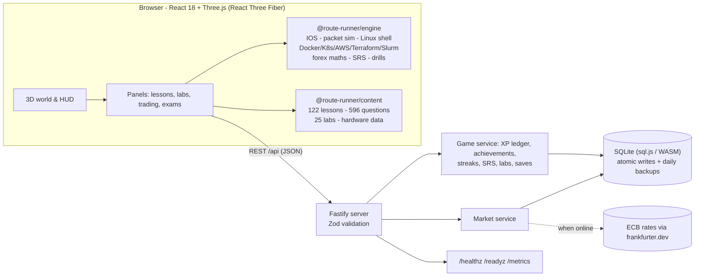

# Route Runner

**A 3D learning game that trains one person - Phemelo - to become a Network Engineer (CCNA), a Cloud Engineer and a disciplined Forex Trader.** Walk a voxel island, enter buildings, take lessons, fight chapter bosses, configure simulated Cisco routers, administer Linux servers, deploy to Kubernetes, build server racks, and practise trading on real market data. It runs completely offline and saves your progress after every action.

   

---

## Play it (Windows)

```cmd
git clone https://github.com/PhemeloMartin/Route-Runner.git
cd Route-Runner
setup.cmd          :: once, needs internet: installs, builds, downloads market data, registers the command
play.cmd           :: every day after that - works offline
```

After setup you can type `route-runner play` in **any** cmd window. Other commands:

| Command | What it does |
|---|---|
| `route-runner play` | starts the local game server and opens the game in your browser |
| `route-runner status` | your level, streak and today's quest - right in the terminal |
| `route-runner backup` | copies your save database to the current folder |
| `route-runner where` | shows where the save file lives (`%LOCALAPPDATA%\RouteRunner`) |

Requirements: Node.js 20+ (LTS) and a modern browser. No database server, no Docker and no C++ build tools are needed.

**Controls:** `W A S D` walk · `Shift` run · `Space` jump · drag the mouse to look · wheel to zoom · `E` enters the building in front of you · `Esc` closes a window.

---

## What's inside

| Building | What you learn and do |
|---|---|
| 🌐 **Network Academy** | 20 chapters (59 lessons) from "how a computer works" to CCNA v2.0: OSI, Ethernet, IOS, IPv4, subnetting/VLSM, IPv6, TCP/UDP, VLANs, STP/EtherChannel, static routing and OSPF, wireless, DHCP/DNS/NAT/HSRP/QoS, security and ACLs, AI and automation, data centres, troubleshooting |
| 🔌 **Packet Lab** | 3D lab bench of routers, switches and PCs. Click ports to cable them, then configure real **Cisco IOS commands** (modes, abbreviations, `?` help). Covers VLANs, trunks, router-on-a-stick, static routes, OSPF, DHCP and relay, NAT/PAT, ACLs, HSRP, STP, EtherChannel and SSH. 15 missions, including troubleshooting tickets and a capstone, plus a sandbox |
| ☁️ **Cloud Tower** | 12 chapters (34 lessons): Linux, virtualization, cloud concepts, AWS (IAM, EC2, S3, VPC), Docker, Kubernetes, DevOps/CI/CD/IaC/observability, HPC, security and cost, career |
| 🐧 **Server Room** | Ubuntu 24.04 shell simulator: files, permissions, users, apt, systemd, netplan, UFW, SSH keys, scripts and pipes. Includes a **VirtualBox-style VM Manager** with NAT, bridged, host-only and internal modes, plus snapshots |
| ☸️ **CloudShell** | Simulated `docker`, `kubectl`, `aws` (af-south-1), `terraform` and `ansible`, plus a **3D Kubernetes cluster view**: watch pods heal and reschedule when you crash a node |
| 🧮 **Supercomputer** | HPC login node: Slurm (`sbatch`, `squeue`, `sinfo`), environment modules, MPI and GPUs |
| 🗄️ **Data Centre** | 3D 42U rack builder graded on best practice, with a hot/cold-aisle airflow and temperature view |
| 🖥️ **PC Workshop** | 3D PC assembly where every part explains itself, followed by a POST/boot sequence and case airflow |
| 🧵 **Cable Bench** | Crimp RJ45 to T568A/B and choose the right cable for each job |
| 📈 **Trading Floor** | 10-chapter forex course (29 lessons) for absolute beginners. **Real ECB exchange rates** for 13 pairs including USD/ZAR, candlestick charts with SMA/RSI/S-R/patterns, **bar replay**, a demo account with stop-loss and take-profit, risk-first order ticket, trade journal, calculators, and a session clock in SAST |
| 🎓 **Exam Hall** | CCNA mock exams weighted by the **v2.0 blueprint** domains, endless subnetting/binary/IPv6/port/forex-maths drills, and spaced-repetition flashcards (665 cards, SM-2) |
| 🏠 **Phemelo's Room** | Character customisation, ranks per stream, streak heatmap, achievements, settings, save export/import |

Learning loop: **lesson** (plain English with an analogy, key terms, "say it like a pro" lines with read-aloud, and an interview question to practise speaking) -> **quiz** -> **lab** -> **boss battle** -> **flashcards and drills** -> **mock exams**. Every step earns XP, and a daily quest plus streak keep you coming back.

---

## Architecture



- **The simulators run in the browser** as pure TypeScript, so labs respond instantly and work offline. The server persists lab state as JSON.
- **The content is code**: lessons are written in a small text format (`packages/content/src/dsl.ts`) and parsed into typed objects. Tests check that every lesson, question and lab link is complete.
- See **[docs/ARCHITECTURE.md](docs/ARCHITECTURE.md)** for design decisions and the database model, and **[docs/STUDY-PLAN.md](docs/STUDY-PLAN.md)** for the 13-week plan.

### Tech stack

| Layer | Choice | Why |
|---|---|---|
| Language | TypeScript (strict) everywhere | one language, shared types between client, server, engines and content |
| 3D | three.js, @react-three/fiber, drei | declarative 3D in React; every model is procedural, so no asset downloads are needed offline |
| UI state | React 18, Zustand | small and predictable |
| Charts | TradingView lightweight-charts | an industry-standard financial charting library |
| API | Fastify 5, Zod | fast, schema-validated input, easy to test with `inject()` |
| Database | SQLite via sql.js (WebAssembly) | embedded, ACID, zero-install, and no native compiler needed on Windows |
| Tests | Vitest (60 tests) | engine scenarios, API integration, curriculum integrity |
| Build | Vite (client), esbuild (server bundle), npm workspaces | fast builds |
| Ops | Docker multi-stage (non-root, healthcheck), docker-compose, Kubernetes + Kustomize, GitHub Actions | production-style delivery |
| Observability | `/healthz`, `/readyz`, Prometheus `/metrics`, structured logs (pino) | probes and scraping out of the box |

---

## Develop

```bash
npm install
npm run dev          # server on :7420 (tsx watch) + Vite on :5173 with an /api proxy
npm test             # 60 tests
npm run typecheck    # all four projects
npm run build        # production client + bundled server
npm run market:seed  # refresh data/seed/market.json with the latest ECB rates
npm run content:check
```

Repository layout:

```
apps/client        React + R3F game (world/, panels/, ui/)
apps/server        Fastify API, SQLite data layer + migrations, market & game services
packages/engine    simulators: net/ ios/ host/ shell/ cloud/ forex/ learning/
packages/content   curriculum (network/ cloud/ forex/), labs, achievements, DSL parser
bin/route-runner.mjs   command-line launcher
deploy/k8s         Kubernetes manifests (kubectl apply -k deploy/k8s)
data/seed          bundled real market data for offline play
```

## Run in a container or on Kubernetes

```bash
docker compose up -d                       # http://localhost:7420, data in a named volume
kubectl apply -k deploy/k8s                # namespace, PVC, Deployment (probes, limits, non-root), Service, Ingress, NetworkPolicy
```

The save game is one SQLite file, so the Deployment runs **one replica with `strategy: Recreate`** on a ReadWriteOnce volume. A multi-user version would swap the data layer for PostgreSQL; the repository layer is isolated in `apps/server/src/services` to make that change straightforward.

## Honesty notes

- The network, Linux and cloud tools are **simulators** built to teach real commands and real behaviour, not full emulators. Confirm anything important on real gear or a VM; the VMware Workstation installer and Ubuntu ISO you already own are ideal.
- CCNA v1.1 is available until 2 Feb 2027 and v2.0 starts 3 Feb 2027. Check Cisco's official exam-topics PDF before booking.
- Market data is real (ECB reference rates, one fix per day), but candles are built from daily fixes, so a broker's intraday highs and lows will differ.
- **The forex content is education, not financial advice.** Trade demo first, and only ever use an FSCA-authorised broker with money you can afford to lose.

## License

MIT © Phemelo Martin Mashome
