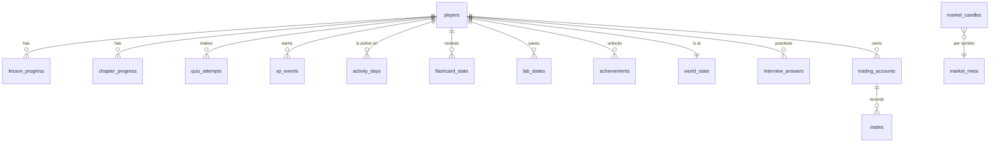

# Architecture & design decisions

## Goals that shaped the design

1. **Offline first.** One `play.cmd` starts everything, with no internet, database server or Docker required.
2. **Never lose progress.** Every action is saved immediately and the player can resume where they left off.
3. **Teach the real thing.** Labs accept genuine Cisco IOS and Linux commands and react the way real systems do, including their error messages.
4. **Portfolio quality.** Typed end to end, tested, containerised, deployable to Kubernetes, and observable.

## Packages

| Package | Responsibility | Notes |
|---|---|---|
| `packages/engine` | Pure simulation and game logic, with no DOM or Node APIs | runs in the browser for labs and in Node for tests and the server |
| `packages/content` | Curriculum, labs, hardware data, achievements | depends on the engine, because lab objectives call the simulators |
| `apps/server` | HTTP API, persistence, market data | bundled into one ESM file with esbuild |
| `apps/client` | 3D world and all panels | Vite build; each heavy panel is lazy-loaded |

### The network simulator (`engine/src/net`, `engine/src/ios`)

It models **decisions**, not electrical signals:

- **Interface status** follows IOS rules: router ports start `administratively down`; a port is up/up only with a valid cable to an enabled peer; an SVI needs an active port in its VLAN.
- **Layer 2 flooding** walks cables and switches while honouring access and trunk modes, 802.1Q tags, the native VLAN, allowed-VLAN lists and DTP. It returns every Layer 3 interface in the broadcast domain, which is the basis for ARP.
- **Forwarding** does a longest-prefix match over connected, static and OSPF routes, resolving administrative distance between sources. Each hop applies inbound/outbound ACLs and NAT, then ARPs for the next hop. Ping succeeds only if the reply can also get back, so a missing return route fails exactly as it does on real gear.
- **OSPF** forms adjacencies when area, subnet, mask and passive state match, then runs Dijkstra over link costs. **DHCP** implements DORA with pools, exclusions, relay via `ip helper-address`, and APIPA fallback. Also modelled: **HSRP** election, **STP** root and port roles, and **PAT and static NAT**.
- The **IOS CLI** is a table-driven parser with prefix abbreviations, `?` help, ambiguity detection and caret-marked error messages. Its `show` output matches the real format.

### The shell simulator (`engine/src/shell`, `engine/src/cloud`)

A bash-like tokenizer handles quotes, `$VARS`, globs, pipes, redirection, `&&`/`||`/`;`, for-loops and scripts. It runs over a JSON virtual filesystem with users, permissions and sudo. Commands include apt (internet depends on the VM network mode), systemd, netplan (parses YAML and applies it to the NIC), UFW, ss, curl and nmap. The cloud and HPC tools (docker, kubectl with a reconcile loop, aws, terraform, ansible, slurm) share one machine state, so `curl localhost:8080` reaches a container you just started.

### The developer tools (`engine/src/dev`)

The App & DevOps stream adds a **Dev Studio** machine profile with simulated `dotnet`, `flutter`/`dart`, `helm` and `act`. They model the real commands, files and error messages (NU1101, MSB1003, "doesn't reference Microsoft.EntityFrameworkCore.Design", "is not a valid Dart package name"...) without compiling real code:
- **dotnet** creates real-looking projects, "compiles" by checking brackets and package references, records EF Core migrations, and a running API answers `curl` by reading the routes in Program.cs / controllers (MapGroup prefixes, route parameters, a CRUD store for todo routes, string-literal endpoints).
- **helm** renders a chart's values into a Deployment and Service on the simulated cluster and keeps numbered revisions, so upgrade and rollback behave like the real thing; nodes can pull images that were pushed to the simulated registry.
- **act** parses `.github/workflows/*.yml`, validates triggers, jobs, runners and actions, and **really runs every `run:` step** in the same shell - so a failing `dotnet test` turns the pipeline red and skips dependent jobs.

### Rendering (`client/src/world`)

Smooth heightfield terrain shared with the player controller (`ground.ts`), instanced foliage and grass with wind shaders, procedural canvas textures (nothing to download), a gradient sky driven by SAST time, an environment map captured from that sky for reflections, and shadows that follow the player. Quality tiers (Low / Medium / High / Ultra, default **Auto** from the GPU name) switch shadows, grass density and the post-processing pipeline (bloom, optional N8AO); a PerformanceMonitor steps down automatically. Floating labels are WebGL sprites rather than DOM overlays, because per-frame DOM updates over a live canvas cost more than the whole scene on integrated GPUs.

## Database design (SQLite)

Why SQLite: the game is single-player and offline, and SQLite gives ACID transactions, foreign keys, CHECK constraints and partial indexes in one file. **sql.js** (SQLite compiled to WebAssembly) avoids native compilation on the learner's Windows PC. After each write, the in-memory database is flushed (debounced) with an atomic **write-temp-then-rename**, and a dated backup is taken at startup (last 7 kept).

Key decisions:

- **XP is an append-only ledger** (`xp_events`). Totals per stream come from the view `v_xp_by_stream`. A **partial unique index** on `(player_id, reason, ref_id) WHERE reason IN ('lesson','lab','boss','achievement')` makes one-time rewards idempotent at the database level, so a double click or a retry can never award XP twice.
- **Content is not stored in the DB.** Lessons live in versioned code and the DB references them by stable text ids. This keeps learner state separate from course material.
- **Multi-player ready.** Every learner table has `player_id REFERENCES players ON DELETE CASCADE`, even though the offline game creates one player.
- **Integrity in the schema:** CHECK constraints on enums and ranges (scores 0-1, `correct <= total`, a closed trade must have an exit price), `WITHOUT ROWID` for compact keyed tables (`market_candles`, `activity_days`, `flashcard_state`), and indexes that match the dashboard queries.
- **Forward-only migrations** are recorded in `schema_migrations` and applied in a transaction at startup.

### Migration 2 - adding a stream without losing anyone's progress

SQLite cannot ALTER a CHECK constraint, so migration 2 rebuilds lesson_progress, chapter_progress, xp_events and lab_states with the new allowed values (stream 'dev', lab kind 'dev'), copies every row across, recreates their indexes (including the partial unique index that stops one-time rewards being claimed twice) and the v_xp_by_stream view, all inside the migration transaction. `apps/server/test/migrations.test.ts` builds a version-1 database with progress, upgrades it, and checks nothing was lost.

## API

REST over JSON. All input is validated with Zod (400 on bad input, 404 on unknown ids, 409 on conflicts). Main groups: `/api/profile`, `/api/progress`, `/api/lessons/:id/complete`, `/api/chapters/:id/boss`, `/api/exam/*`, `/api/drills`, `/api/flashcards/*`, `/api/labs/:kind/:id`, `/api/world`, `/api/market/*`, `/api/trading/*`, `/api/save/*`. Ops endpoints: `/healthz` (liveness), `/readyz` (runs a DB query), `/metrics` (Prometheus text format).

## Market data

ECB reference rates come from frankfurter.dev (free, no API key). A seed file with 13 pairs since 2022 ships in `data/seed`, so the Trading Floor works on first launch with no internet. When online, the server tops up any missing days in the background. Daily candles use the previous fix as the open; weekly candles are built from the daily fixes, grouped by ISO week.

## Testing

- `packages/engine/test` covers router-on-a-stick, OSPF convergence, DHCP relay, NAT, ACLs, SSH, the reload-without-save trap, Linux permissions, netplan, Docker, Kubernetes self-healing and rollback, Terraform, Slurm, forex maths and SRS.
- `apps/server/test` runs API integration tests against an in-memory database: one-time XP, validation, saves, market data, the trade journal, and export/import.
- `packages/content/test` checks curriculum integrity: every lesson is complete, every question is answerable, every lab link resolves, every lab starts unsolved, and the troubleshooting tickets are solvable.

## Scaling beyond one player

To host the game for many learners: move the repository layer to PostgreSQL (the SQL is portable apart from `INSERT OR IGNORE`, which becomes `ON CONFLICT DO NOTHING`), add authentication, run multiple stateless replicas behind the Service, and keep `/readyz` checking the database.
